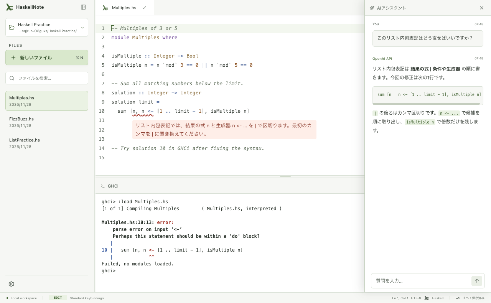

# HaskellNote — Haskell workspace



## 機能の概要

小さなHaskellのIDEです。AIアシスタント機能があります。

- Haskellのシンタックスハイライト、ファイル内の単語補完します。美しいテーマ選択とフォント設定。
- GHCiターミナル組み込み。⌘Enterで起動してファイル読み込み、即時にテスト・実行確認できます。
- GHCiのエラーを裏でAIが解析し、該当箇所に下線を引き、直下に日本語の説明を表示します。
- チャットでAIに相談できます。AIは設定でOpen AI APIとCodex app-serverを選べます。
- シンプルなvimモード（On/Off可能）

操作方法とショートカットは[使い方](docs/usage.md)、開発・環境変数・検証は[開発ドキュメント](docs/development.md)を参照してください。

## 起動方法

Node.js 22.12以降、GHC/GHCi、Codex CLIを用意して実行します。

```sh
./start.sh
```

初回は必要な依存パッケージを自動インストールし、ビルドして起動します。別のディレクトリから絶対パスで実行することもできます。AIを使う前に、未ログインの場合はターミナルで `codex login` を実行してください。

## Macアプリのビルド

macOS上で実行します。必要な依存パッケージのインストール、画面のビルド、アイコン付き `.app` の生成をまとめて行います。

```sh
./build-mac.sh
```

生成先は `release/HaskellNote-darwin-arm64/HaskellNote.app`（Apple Silicon）または `release/HaskellNote-darwin-x64/HaskellNote.app`（Intel）です。`HaskellNote.app` をアプリケーションフォルダーへコピーして起動できます。GHC/GHCi・Codex CLIは別途インストールが必要です。

アイコン・設定の保存先・署名などの詳細は[Macアプリのビルド詳細](docs/mac-build.md)を参照してください。
